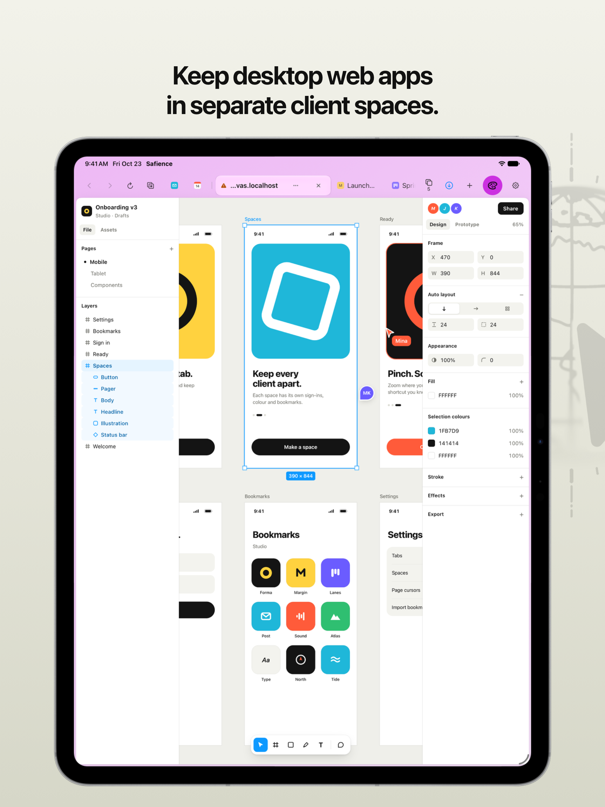
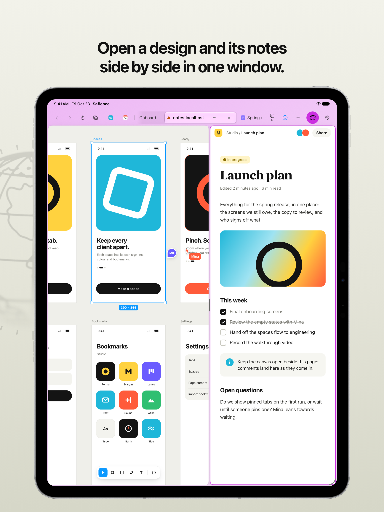
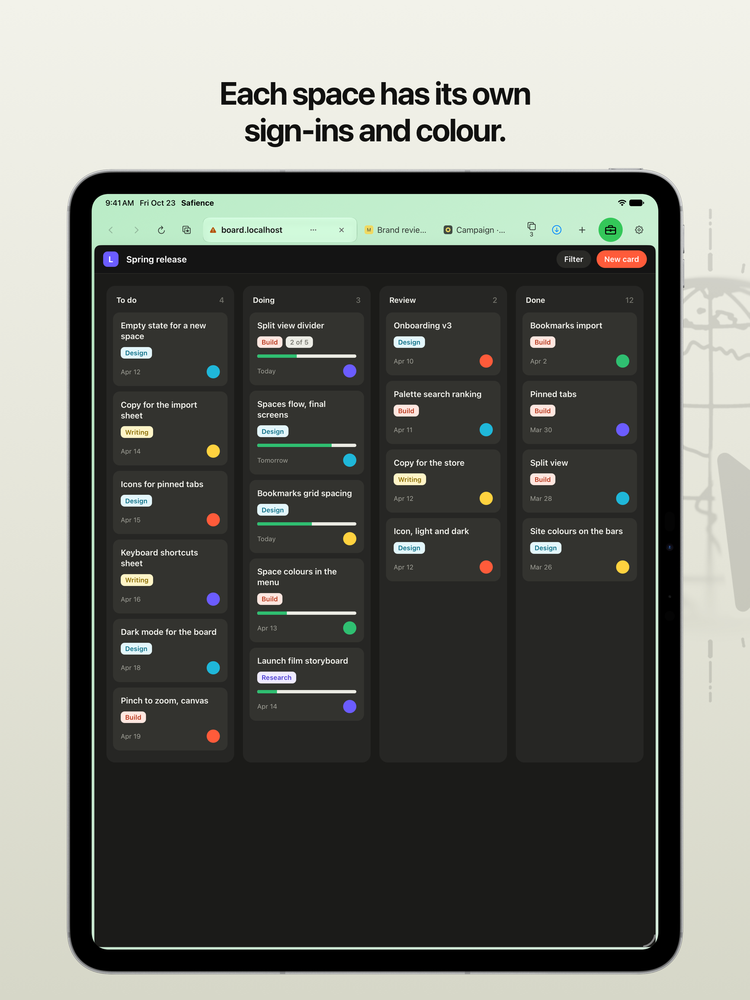
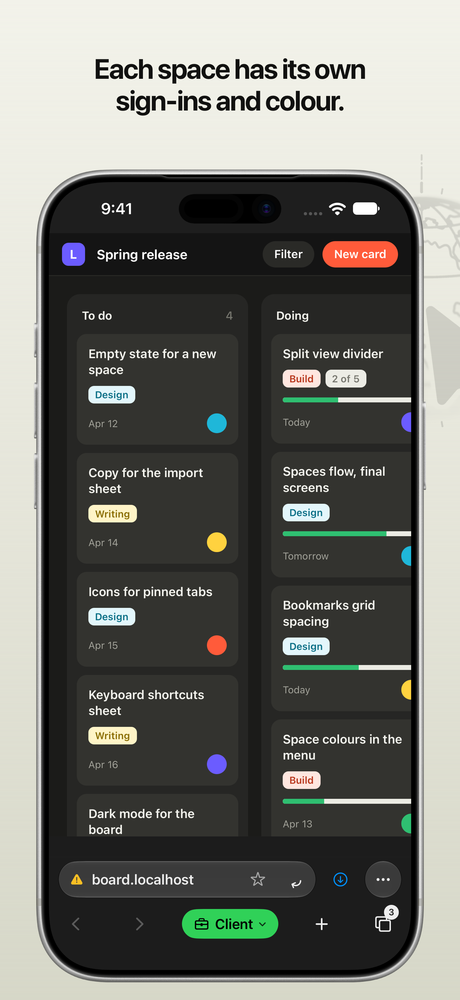
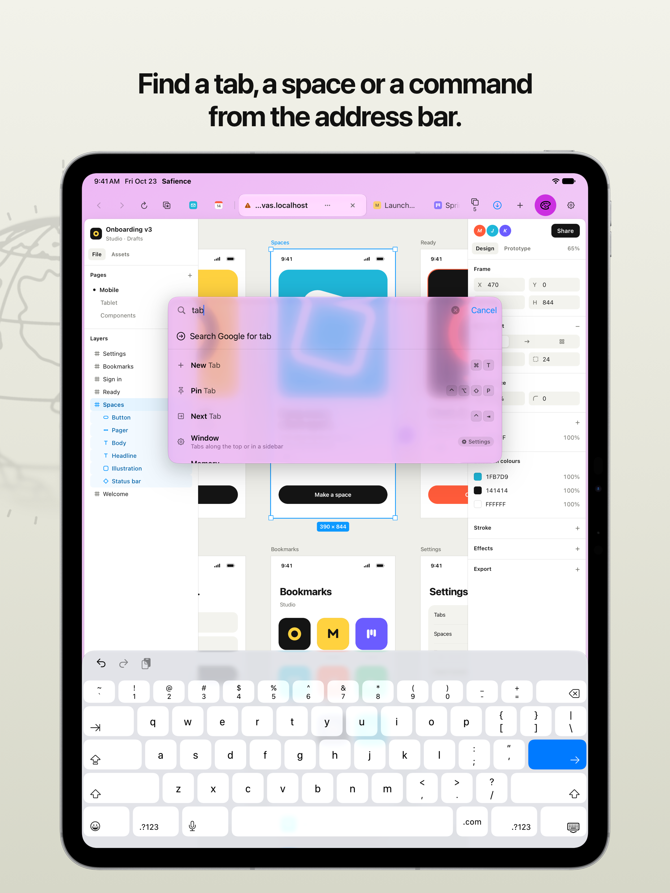
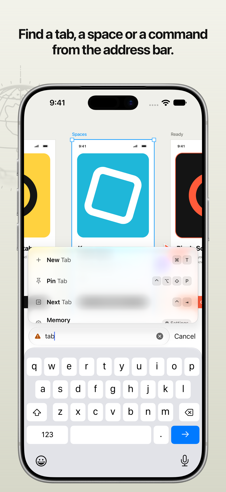
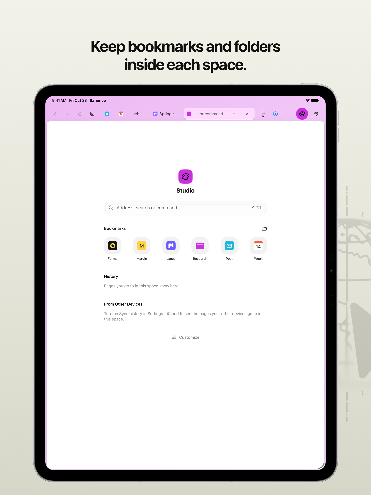
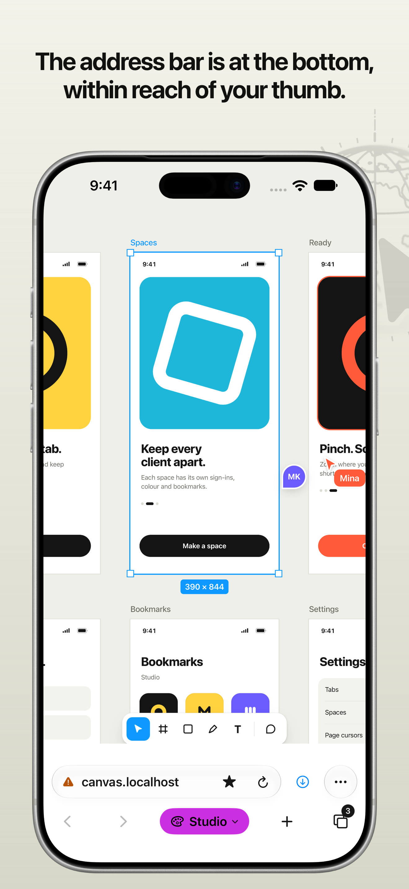
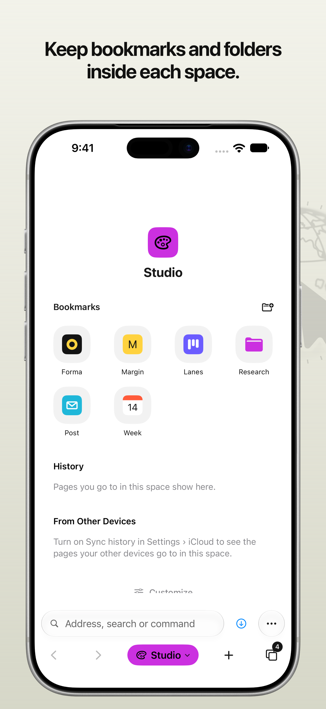

<p align="center">
  
</p>

<h1 align="center">Safience</h1>

<p align="center">
  A web browser for iPad and iPhone, made for desktop web apps<br>
  used with a trackpad and a keyboard.
</p>

<p align="center">
  <a href="https://apps.apple.com/app/id6818395717"></a>
</p>

Safience is a WebKit browser for working in web apps such as Figma, a whiteboard, a project board or a CMS. On iPad, sites load their desktop versions, and the trackpad's pinches and scrolling and every ⌘ shortcut go to the page, as they would in Safari on a Mac. On iPhone, the bar sits at the bottom within reach of your thumb, and Desktop View turns the screen into a trackpad for a site's desktop version. Spaces keep each client's sign-ins apart, and iCloud carries your spaces, bookmarks and pinned tabs to your other devices. Open tabs stay on each device.

No account, no server of ours, no analytics. What Safience keeps stays on your devices, or in your own iCloud if you turn sync on. Besides the pages you open, it can ask your search engine for suggestions after you explicitly enable them for that provider (off by default), sites' icons and updated ad-blocking lists; and on a Mac, the Chrome extensions you add and their updates.

## Contents

- [Install](#install)
- [Features](#features)
- [Keyboard shortcuts](#keyboard-shortcuts)
- [FAQ](#faq)
- [Privacy](#privacy)
- [Known limitations](#known-limitations)
- [Build from source](#build-from-source)
- [Contributing](#contributing)
- [Security](#security)
- [Disclaimers](#disclaimers)
- [Credits](#credits)
- [License](#license)

## Install

Get Safience from the [App Store](https://apps.apple.com/app/id6818395717). It is one app for iPad and iPhone.

| Device | Needs | Gets |
|---|---|---|
| iPad | iPadOS 17 or later, and a trackpad and keyboard (Magic Keyboard, Magic Trackpad) to get the most from it | Desktop sites, the trackpad and ⌘ keys for the page, split view, Stage Manager windows |
| iPhone | iOS 17 or later | The bar at the bottom, mobile sites, Desktop View |

- On iOS and iPadOS 26 or later, the bars are in Liquid Glass, and on iPad the menu bar lists every command with its keys.
- With Apple Intelligence on (iOS and iPadOS 26 or later), the address bar also finds tabs, bookmarks and commands by what your words mean.

### First steps

1. **Open Safience.** A welcome sheet asks you to name a first space and give it a colour and an icon, offers to bring in your bookmarks, to make Safience your default browser and to turn on iCloud. Every step can be skipped. There is no account to make.
2. **Open a tab.** Press ⌘T or tap **+**, then type an address, a search, or the name of a tab, a space, a command or a part of Settings.
3. **Find Settings.** On iPad it is at the end of the current tab's menu, or press ⌃⌥, (Control, Option, comma). On iPhone it is at the end of the page's menu (the **…** button). The command bar finds it too.

### Make Safience your default browser

In the Settings app, go to **Apps › Default Apps › Browser App** and choose Safience. Before iOS and iPadOS 18.2, it is **Settings › Safience › Default Browser App**. Safience's own Settings has a button that goes there, and on 18.2 or later says whether Safience already is the default. Links from other apps then open in a new tab.

### Bring your bookmarks

Export them from your old browser, then import them in Safience's Settings, on an empty start page, or with ⌃⌥⇧I.

| From | Export |
|---|---|
| Chrome, Edge, Brave and other Chromium browsers | Bookmark manager › **⋮** › Export bookmarks (a `.html` file) |
| Firefox | Bookmarks › Manage bookmarks › Import and Backup › Export Bookmarks to HTML |
| Safari | File › Export Browsing Data to File (a `.zip`, read as it is) |

Each space keeps its own bookmarks, so import into the space they belong to.

### Turn on iCloud sync

Settings › iCloud. Your spaces (their names, colours, icons, bookmarks and pinned tabs) then show on every iPad and iPhone signed in to the same Apple Account. Open tabs, sign-ins, cookies and site data stay on each device. Sync is off until you turn it on.

## Features

### The trackpad and the keys go to the page

<p align="center">
  
</p>

iPad's own trackpad and keyboard handling (page zoom, scrolling, swipe back, the menu bar's ⌘ shortcuts) is turned off or handed to the page, so a web app gets what it would get from Safari on a Mac.

- **A pinch zooms the canvas, not the page**, around the pointer. ⌘ with two fingers zooms too, and two fingers pan, gliding on after a flick as on a Mac.
- **Every ⌘ shortcut belongs to the page**: ⌘Z, ⌘F, ⌘D and each web app's own. The browser keeps only the keys every browser keeps (⌘T, ⌘W, ⌘N and a few more) and puts its other shortcuts on ⌃⌥, which pages leave alone. See [Keyboard shortcuts](#keyboard-shortcuts).
- **Desktop sites, as Safari on a Mac.** Pages are asked for in their desktop versions with Mac Safari's user agent, so web apps serve their full version. Request Desktop or Mobile Site (⌃⌥⇧M) asks a site for the other version, and remembers.
- **Pages' own cursors.** Figma's arrow and its tools' cursors show, which WebKit on iPad never shows.
- **⌘-click opens a link in a new tab** behind the one you are on, as in Safari; ⇧⌘-click opens it in front, and a mouse's middle button behind.
- **Swipe back that asks the page first.** Two fingers sideways go back only when the page had no use for the swipe, so a canvas that pans sideways keeps it.

### Split view

<p align="center">
  
</p>

Two tabs side by side in one window, shown as one tab in the row, as in Dia. A click in a pane gives it the keys and the bars, the divider drags for more room on one side (a double tap puts it back in the middle), and both pages stay live.

- Open one from a tab's menu (**Open in Split View**), the **+** button's menu (**New Tab in Split View**), or press ⌃⌥\\.
- Or drag a tab from the row or the sidebar onto the page (iPadOS 27 or later), as in Dia: a card at each side shows where it goes, and the one under your finger grows to the pane it will open as. Dropped on a split, it takes that side's place.
- In a window narrower than two pages, only the pane with the keys shows.

### Spaces, each signed in on its own

<p align="center">
  
  
</p>

A space has its own tabs, its own cookies and sign-ins, and its own bookmarks. A client's Figma and your own can both stay signed in, one per space.

- **A colour and an icon fill each space's button**, so you can see which space a window is in.
- **New Space** is in the space button's menu, or press ⌃⌥⇧N. Space Settings (⌃⌥⇧S) sets the name, colour and icon; Settings › Spaces puts them in order.
- **Switch** with the space button, ⌃⌥↑ and ⌃⌥↓, or by typing the space's name in the command bar.
- Removing a space erases its sign-ins and site data.

### The command bar

<p align="center">
  
  
</p>

The address field and the command palette are one bar. On iPad it floats over the page, as Arc's and Spotlight's do; on iPhone it is the bar at the bottom.

- **⌘T or +** opens a new tab with the bar over it. **⌃⌥K** opens it without a new tab. A click on the address opens it holding the address.
- **Type to find anything**: an address or a search, an open tab in any space, a bookmark, a space, a command, or a part of Settings ("change icon", "ad blocker", "duckduckgo").
- **Every command shows its keys**, so the bar is also the cheat sheet of the shortcuts.
- **Suggestions as you type**, each row saying where it came from: an open tab, a pinned tab, a bookmark, a command, or the search engine. ↑, ↓ and Return choose one. An open tab is gone to rather than opened again.
- **Your history**: pages you went to in the space, found by any part of a word, their address or what they say they are about ("은행" finds 우리은행, "materials glass" a page that only mentions glass), and searches you typed before. Words for when narrow it: "figma yesterday", "지난주 강좌".
- **With Apple Intelligence** (iOS and iPadOS 26, macOS 26), Apple's on-device model also finds tabs, bookmarks, pages in your history and commands by what your words mean ("that article about window glass"), in any language it knows, and sends nothing anywhere.
- Search engine suggestions are off by default. Settings › Search chooses the engine and lets you explicitly enable suggestions for that provider. Requests use no cookies. Recognized complete addresses are excluded; a partial address may be sent before recognition. Changing providers turns suggestions off again.

### History

Show All History (⌘Y on a Mac, ⌃⌥Y on iPad, or the page menu's History) lists the space's pages by day, each page once a day, and searches them as the command bar does. With Apple Intelligence, press Return to search by what you remember: "the glass article from last Friday", "지난 금요일에 본 기사". A page goes from history with a swipe or its menu, a day with its Clear, and Clear History takes the last hour, today, today and yesterday, or everything, in one space or all of them; closed tabs from that time go from Reopen Closed Tab too.

History is kept for a month unless Settings › History says otherwise (a day, a week, a year, or until cleared). Sign-in pages, pages that ask for a password and pop-ups are never kept. With Settings › iCloud › Sync history on, visits linked to the approved Apple Account can appear on your other devices, encrypted in your iCloud. Visits saved before account approval, while account verification is unavailable or while main iCloud sync is off stay on this device. Existing untagged history remains locally available after upgrading and is not newly uploaded. Previously synced records are retained until clearing or normal retention. Clearing history while approved history sync is active also clears it on devices syncing that account.

### Bookmarks on every new tab

<p align="center">
  
</p>

A new tab shows the space's bookmarks as a grid of site icons, folders and all.

- **Add or remove the page** with the star in the address, or ⌃⌥⇧D.
- **Folders**: the folder button by the heading makes one; a bookmark's menu has Rename… and Move to….
- **Import** from Chrome, Firefox or Safari (see [Bring your bookmarks](#bring-your-bookmarks)).

### Tabs that keep out of the way

- **One row, as Safari's compact layout.** The tab you are on is the address: it shows where it is, with its … and ✕, and a click on it types a new one. The other tabs sit beside it, flat, the pinned ones as icons. The row is the same on iPad and Mac.
- **Or a sidebar, as in Arc.** Settings › Window › Tabs › In a Sidebar puts the tabs down the window's side, with the address, the pinned tabs as tiles, a Bookmarks row that brings the space's bookmarks out over the list (a click opens one here, ⌘-click in a new tab), and the space at the foot. The sidebar button, or ⌃⌥B, puts it away. With the tabs along the top, the button beside New Tab shows the bookmarks in a bar under them.
- **A search shows its words.** A page of results from your search engine shows what you searched for in the address, not the engine's address.
- **The space's colour round the page**, as on the Mac: on iPad the page is a card on it, beside the row of tabs or the sidebar. On iPhone the bar takes on the colour of the page under it, so bar and page read as one.
- **Pinned tabs, as in Dia and Arc.** A pinned tab is an icon at the front of the row that keeps its page: closing it unloads it and takes it back to the address it was pinned with. Pin or unpin with ⌃⌥⇧P or the tab's menu.
- **⇧⌘T** brings back the last tab you closed.

### On iPhone: the bar at the bottom

<p align="center">
  
</p>

On a phone-width window (an iPhone upright, most iPhones turned, the iPhone Duo closed, a narrow iPad window) the bar moves to the bottom, where a thumb reaches: the address with the page's menu beside it, and under it back, forward, the space, a new tab and the tabs. Such a window gets mobile sites, with Safari's iPhone user agent, touch scrolling and pinch zoom; a window at least 600 by 500 points gets desktop sites. A large iPhone turned (a Pro Max or a Plus, and the iPhone Duo open) is as wide as an iPad's window and has its bars, Split View and Request Desktop Site, and keeps Desktop View.

On the iPhone Duo closed, the system's strip beside the screen has back and forward at its top, the page's menu under them, and a new tab and the tabs at its foot, with the count of tabs; the bar at the bottom is one row, the space and the address, so more of the page shows. Open, the strip has the same tools beside the iPad's bars, and its tabs button shows or hides the tab bar (with the tabs in a sidebar, the sidebar's own button does). Opened like a book with the tabs in a sidebar, the sidebar reaches the fold and the page fills the other half. What is being typed goes over to the other screen's field as it folds or unfolds.

- **Swipe up on the bar** for your tabs as cards, with your pinned tabs in a dock at the bottom. Swipe a card sideways to close it; touch and hold one for more, or hold it and move it to put the tab elsewhere.
- **Swipe sideways on the bar** to go to the tab beside, as in Safari.
- **Swipe from the screen's edge** to go back or forward, and **pull down** to reload.

### Desktop View on iPhone

<p align="center">
  
</p>

For a web app now and then on your phone. **Desktop View**, in the page's menu, lays the page out at an iPad Pro 13-inch's size and turns the screen into a trackpad, as Jump Desktop's trackpad mode does.

| Do | To |
|---|---|
| Move one finger | Move the cursor; the view follows it. Pushed against the top or bottom of the page, the cursor scrolls |
| Tap, or tap twice | Click, or double-click |
| Touch and hold, then move | Drag |
| Tap with two fingers | Right-click |
| Move two fingers | Scroll |
| Pinch | Zoom the view |
| Tap the minimap (top right) | Go to that part of the page; drag it to move it to another corner |
| Tap the keyboard button | Type into what you clicked |

Hover styles and the page's cursors show. Settings › Desktop View › Cursor speed sets how far the cursor goes. The clicks are script events, which a few sites ignore, and Google's sign-in stays on plain touch.

### iCloud sync

<p align="center">
  
</p>

With Settings › iCloud on, each space's name, colour, icon, bookmarks and pinned tabs show on your other iPhones and iPads. With its History on too, a new tab lists the pages your other devices went to in the space, to pick up from. It uses CloudKit in your own iCloud, with no server of ours in between. Open tabs, sign-ins, cookies and site data stay on each device.

Safience for Mac, built from this repository ([The Mac app](#the-mac-app)), joins in too, and carries the list of your Chrome Web Store extensions between your Macs.

### Chrome extensions on the Mac

Safience for Mac runs Chrome extensions on Apple's WebKit. It ships as a DMG outside the Mac App Store, so extensions can talk to the desktop apps that go with them, such as Bitwarden's and 1Password's.

- **From the Chrome Web Store**: an extension's store page has an Add to Safience button. Safience checks Google's signature, as Chrome does, and asks first: what the extension asks for, which spaces it goes in, and whether it may read every site it asks for or only the page you click it on. Install from File… takes a `.crx` or `.zip`, and Load Unpacked a developer's folder.
- **Each space its own.** An extension is turned on per space, and keeps its own sign-in and data in each, as the space's sites do. Removing it from a space deletes what it kept there.
- **The puzzle button** shows the space's extensions as tiles of glass, four to a row, as pinned tabs are. Click one to use it: its popup opens in a pane at the page's corner, or its side panel beside the page. Drag a tile to reorder them; right-click one, or hold it, for its options. Manage Extensions lists every extension with its switch for the space, and each one's page has its site access, its version (click to copy it) and removal.
- **Google's sign-in stays out of reach.** No extension gets Chrome's cookies API, and none runs on accounts.google.com, whatever it asks for. On the sites you allow it, an extension's scripts see the page as the page's own scripts do.
- **It says when something doesn't work.** On install, Safience reads the extension and tries its pages in a temporary space that keeps no data, though they can reach the servers the extension uses. A row says nothing until something is found: "Some Features Don't Work" when some of it doesn't, and "Incompatible", with a warning triangle in place of its switch, when it can't run on this Mac. No warning is no promise: only what was tried was checked. This Looks Wrong hides a warning and gives an incompatible one its switch back; Report a Problem… shows a report to copy or save, and sends nothing.
- **Updates** come from the Chrome Web Store about once a day, tried before they replace the version you have; one that asks for more asks you first. Settings › Extensions turns the daily check off, and Check Now checks at once.
- **Between Macs**, with iCloud sync on, the list of your Chrome Web Store extensions follows you, encrypted: each one's name and site access, and the spaces it is on in. Each Mac downloads an extension itself; one you haven't got on a Mac is offered in its puzzle button's list, under On Your Other Macs. Removing one on a Mac removes it, with what it kept, on your other Macs too. Extensions from a file or a folder stay on their Mac.

### And more

- **Ads and trackers blocked** before they load, with WebKit's content blocker and filter lists: EasyList, EasyPrivacy and YousList (for Korean sites) ship with the app, and Settings › Ads and Trackers › Filter lists has more, by language. On by default. Allow a site with Block or Allow Ads on This Site (⌃⌥⇧A, or the site's menu), or turn it off in Settings › Ads and Trackers.
- **Handoff**, on a device with Apple Intelligence, if you turn it on (Settings › Handoff): the page on screen goes to an assistant such as Claude or ChatGPT as a Markdown file with its address, through the share sheet, and you ask your question there (⌃⌥H, or the page's menu). What goes is fitted to the page: an article whole, a landing page with its prices and questions whole and its other sections started, search results as a line each, and comments and related links named and set aside. A video on YouTube goes with its transcript, which Safience gets from the site's own panel without showing it. The file says what is not in it: the site's menus and foot, pictures with no description, a video with no transcript, a page whose words are drawn and not written. Text you selected goes first. A sheet shows how far the page is, and its Share button opens the share sheet once the file is ready. Nothing goes until you pick an app.
- **Memory spent on what you use.** One heavy tab (a Figma file) stays open while you look elsewhere; other tabs freeze to a picture and load again when opened. A page that runs out of memory reloads by itself.
- **Windows for Stage Manager.** Each window shows a space and a tab, and comes back as it was. ⌘N opens one.
- **Sign-in pages always show their address**, so you can see which site asks for your password. Google's sign-in is never touched: no script, no cookie read.
- **Passkeys, and Add to Home Screen.** Sites can use passkeys, and Share Page (⌃⌥S) puts Add to Home Screen in the share sheet.
- **Find on Page** (⌃⌥F) shows WebKit's find bar. ⌘F stays the page's.
- **Links shared without tracking tags.** Share, Copy Link and Handoff give a page's address without what follows whoever opens it: utm_source, fbclid, gclid and the like, and what YouTube's, X's, TikTok's, Spotify's, LinkedIn's and Reddit's share buttons add.
- **A link's menu** (long press, or a secondary click on iPad): Open in New Tab, Open in Background, Copy Link and Share…. Never over a web app's own menu: 49 web apps that draw their own ship in a list, and Settings › Link menu adds or removes a site.
- **Links for other apps** (`mailto:`, `tel:`, an app's own link) open that app. When a page, not you, sends one, Safience asks first.
- **Eight app icons** to choose from in Settings › App icon.

## Keyboard shortcuts

The browser's own shortcuts are ⌃⌥ (Control and Option), so ⌘, ⌥ and ⇧ stay the page's. The exceptions are the keys every browser keeps for itself and no page can count on: ⌘T, ⌘W, ⇧⌘T, ⌘N, ⇧⌘W, ⌃⇥ and ⌃⇧⇥ (the ones Chrome reserves from pages). Every shortcut is listed beside its command in the command bar, in Settings › Shortcuts, and in the menu bar on iPadOS 26.

⌃ Control · ⌥ Option · ⇧ Shift · ⌘ Command · ⇥ Tab

**Go**

| Keys | Command |
|---|---|
| ⌃⌥L | Open Address (the command bar holding the page's address) |
| ⌃⌥K | Commands (the command bar, everything listed) |
| ⌃⌥[ · ⌃⌥] | Back · Forward |
| ⌃⌥R · ⌃⌥. | Reload Page · Stop Loading |
| ⌃⌥S | Share Page… |
| ⌃⌥⇧M | Request Desktop or Mobile Site |
| ⌃⌥⇧A | Block or Allow Ads on This Site |
| ⌃⌥⇧L | Use or Leave This Site's Own Menus |
| ⌃⌥F | Find on Page… |
| ⌃⌥Y | Show All History (⌘Y on a Mac) |

**Tabs**

| Keys | Command |
|---|---|
| ⌘T · ⌘W | New Tab · Close Tab |
| ⇧⌘T | Reopen Closed Tab |
| ⌃⌥⇧P | Pin or Unpin Tab |
| ⌃⌥\\ | Split or Separate Tabs |
| ⌃⌥⇧D | Bookmark This Page |
| ⌃⇥ · ⌃⇧⇥ | Next Tab · Previous Tab |
| ⌃⌥1 to ⌃⌥9 | A tab by its place; ⌃⌥9 the last |

**Spaces and windows**

| Keys | Command |
|---|---|
| ⌃⌥↓ · ⌃⌥↑ | Next Space · Previous Space |
| ⌃⌥⇧N | New Space |
| ⌃⌥⇧S | Space Settings |
| ⌃⌥⇧I | Import Bookmarks |
| ⌘N · ⇧⌘W | New Window · Close Window |
| ⌃⌥B | Show or Hide Tab Bar |
| ⌃⌥D | Show or Hide Diagnostics |
| ⌃⌥P | Give Keys Back to the Page |
| ⌃⌥, | Settings |

With VoiceOver on, ⌃⌥ is VoiceOver's key; type a command's name in the command bar instead.

## FAQ

<details>
<summary><b>Do I need an account?</b></summary>

No. Safience has no sign-in or account of its own. iCloud sync, if you turn it on, uses the Apple Account already on your device.
</details>

<details>
<summary><b>Why are the browser's shortcuts on ⌃⌥ and not ⌘?</b></summary>

Web apps use ⌘, ⌥ and ⇧ for their own shortcuts (Figma alone has hundreds), and a browser that took ⌘D or ⌘F would take them from the page. ⌃⌥ is a pair pages almost never use. Only the keys every browser keeps (⌘T, ⌘W, ⌘N and a few more) stay the browser's. The command bar shows every command's keys, so you don't have to learn them first.
</details>

<details>
<summary><b>Why do ⌘Tab, ⌘Space, ⌘H and the Globe key still go to iPadOS?</b></summary>

iPadOS keeps those, and its three- and four-finger gestures, for itself. No app can hand them to a page.
</details>

<details>
<summary><b>Can I stay signed in to two accounts of the same web app?</b></summary>

Yes: one space for each. Every space has its own cookie store, so a client's Figma and your own stay signed in side by side.
</details>

<details>
<summary><b>Do my sign-ins sync through iCloud?</b></summary>

No. Spaces, their bookmarks and pinned tabs sync, and history if you turn it on. Open tabs, sign-ins, cookies and site data stay on each device, so you sign in to a site once on each one.
</details>

<details>
<summary><b>A site shows its mobile version on my iPad, or its desktop version on my phone. How do I switch?</b></summary>

Request Desktop or Mobile Site (⌃⌥⇧M, or type it in the command bar) asks the site for the other version, and Safience remembers your choice for that site. On iPhone, Desktop View in the page's menu shows the desktop version with the screen as a trackpad.
</details>

<details>
<summary><b>Why did a tab load again when I went back to it?</b></summary>

To save memory, Safience keeps one heavy tab (such as a Figma file) and two light ones live, and freezes the others to a picture that loads again when you open it. Under memory pressure it keeps none but the tab on screen.
</details>

<details>
<summary><b>How do I allow ads on a site, or turn ad blocking off?</b></summary>

Block or Allow Ads on This Site (⌃⌥⇧A, or the site's menu) allows one site. Settings › Ads and Trackers turns blocking off everywhere.
</details>

<details>
<summary><b>A web app's right-click menu is covered by the browser's. What do I do?</b></summary>

Use or Leave This Site's Own Menus (⌃⌥⇧L, or the tab's menu on iPad) turns the browser's link menu off for that site. Settings › Link menu › Sites with their own menus lists the sites; 49 web apps are on it from the start.
</details>

<details>
<summary><b>Does Safience have extensions, a password manager, history or reader mode?</b></summary>

On a Mac, Safience runs Chrome extensions ([Chrome extensions on the Mac](#chrome-extensions-on-the-mac)); on iPhone and iPad, it has none. It includes per-space history. It has no built-in password manager or reader mode. Passkeys work, and the Passwords app's AutoFill offers the passwords you saved there.
</details>

<details>
<summary><b>Why does Google's sign-in page act like plain Safari?</b></summary>

On accounts.google.com, Safience runs none of its own scripts and reads no cookies, so nothing it does can touch your Google sign-in. If Google refuses a sign-in, a banner points to signing in with email or SSO.
</details>

<details>
<summary><b>Something doesn't work on a site. How do I report it?</b></summary>

Open an [issue](https://github.com/taehee-pd/Safience/issues) with what you did, what you expected, what happened instead, your device and its iOS or iPadOS version, and the site. For anything about the trackpad or the keyboard, a screenshot of the Diagnostics panel (⌃⌥D) on that page helps. A security problem goes through [SECURITY.md](SECURITY.md) instead.
</details>

## Privacy

There is no server of ours, no analytics and no telemetry. Here is everything Safience keeps, and where:

| What | Where | Who can read it |
|---|---|---|
| Spaces, tabs and each space's bookmarks | `workspace.json` in the app's Application Support folder | You |
| History: pages gone to, when, their titles and descriptions, searches typed | `history.sqlite` in the app's Application Support folder, kept for as long as Settings › History says | You |
| The same, if iCloud sync is on | Your private CloudKit database | You |
| Ad-blocking lists | The filter lists turned on in Settings, as they shipped or as last downloaded, in `Filters/` in the app's Application Support folder, and WebKit's compiled rule lists | You |
| Sites' icons | The app's Caches folder, one per site: the icon a page names, fetched by the app without cookies, or carried in a Chrome bookmarks file | You. iPadOS may clear it |
| Pictures of frozen tabs, and what it takes to reopen them | The app's Caches folder; never for a sign-in page | You. iPadOS may clear it |
| Cookies, sign-ins, site data | One WebKit store per space, on the device | The sites that set them |
| Settings | The app's preferences | You |
| On a Mac, Chrome extensions | Each as it came, and a copy prepared to run, in `Extensions/` in the app's Application Support folder; what each keeps, per space, in WebKit's own store | You, and each extension what it keeps |
| On a Mac, what an extension ran into | `Extensions/records.json`: which of its features failed, where in it, how often, when it first and last happened, and the versions around it; never the error's words or an address. At most 200 an extension, for 30 days | You. Report a Problem… shows it, and sends nothing |
| On a Mac, the list of your Chrome Web Store extensions, if iCloud sync is on | Your private CloudKit database, in encrypted fields (end to end with Advanced Data Protection) | You |
| A page handed off (Handoff, off unless you turn it on) | A Markdown file in the app's temporary folder, written when you ask for a handoff and removed at the next one, or at once if no app took it. It holds the page's text as it showed to you, first whatever you had selected on the page, its address without the tags it was reached by (`utm_source`, `fbclid` and the like), and the time it was read by Greenwich's clock. On a device with Apple Intelligence, Apple's model reads the page's title, description, headings and the start of what is under each on the device, to tell its kind and say what it is about | You, and the app you pick in the share sheet |
| Anything else | Nowhere | |

Besides the pages you open and the searches you make, Safience sends requests on its own only for these:

- **Search suggestions**: off by default. After you explicitly enable them for a provider, address-bar typing can be sent there without cookies. Recognized complete addresses are excluded, but partial addresses may be sent. Changing providers requires a new choice.
- **Sites' icons**: the icon a page you visited names, fetched without cookies.
- **Ad-blocking lists**: the filter lists turned on in Settings, each from its authors' server (easylist.to, easylist-downloads.adblockplus.org, secure.fanboy.co.nz or raw.githubusercontent.com), at most once every four days and only if it changed.
- **On a Mac, Chrome extensions**: an extension you add, and its updates, downloaded from Google's Chrome Web Store; and about once a day (again within the hour after a failure), unless Settings › Extensions turns it off, a check for updates that names your store extensions and their versions to Google, as Chrome's does. An extension's worker opens its WebSocket connections through Safience, to the servers it names, with no cookies but with whatever the extension sends. Extensions themselves send what they send, under their own policies.

The privacy policy, [PRIVACY.md](PRIVACY.md), lists everything that leaves your device.

## Known limitations

- iPadOS keeps its own shortcuts (⌘Tab, ⌘Space, ⌘H, the Globe key) and its three- and four-finger gestures. No app can hand those to a page.
- A synthetic event is marked `isTrusted: false`. A page that ignores untrusted wheel or key events can't be reached by the bridges; Validation's first check is that Figma isn't one.
- A frame from another site can't be reached by the wheel bridge; its events go to the frame's element in the page around it.
- A page's own cursor is drawn by the app, so it can trail the pointer by a frame. Cursors given by name (`ew-resize`, `crosshair`, `grab`) show the iPad's pointer, and the text beam is the iPad's own. Settings › Show pages' own cursors turns them off.
- A picture's menu is WebKit's own: the public API asks an app about a link's menu only. So it can't be given Open in New Tab, and at a secondary click the app can't hold it back for a page's own menu as it does a link's; a site that draws its own menus over pictures belongs in Settings › Link menu › Sites with their own menus.
- A swipe sideways on the trackpad goes back only on a page the bridge reaches. A page in a frame from another site, or one that takes the wheel without saying so (a passive listener that moves things itself), can't be told apart from a page with no use for the swipe.
- No built-in password manager or reader mode, and no extensions on iPhone and iPad.
- On a Mac, Chrome extensions run on Apple's WebKit, which lacks some of Chrome's features: `notifications`, `bookmarks`, `history`, `downloads`, `identity`'s Google sign-in, tab capture and the old way of blocking requests, among others. Safience answers some itself (the side panel, offscreen pages, `runtime.getContexts`) and says in an extension's row when a feature it uses doesn't work. Tried on macOS 27.0.1; macOS 26 not yet.
- Handoff is only on a device with Apple Intelligence. It tells what kind of page it has (an article, a landing page, a web app, a list of links, a video's page, a job posting) by counting and with Apple Intelligence on the device. A job posting is told where the page declares it (as Lever's, Ashby's, Workday's and Wanted's do), and on Greenhouse, Ashby and Workday boards by its address; the form to apply with is set aside. A discussion or a product page is not told apart yet and goes whole. Paragraphs of 200 characters or more always go whole, outside what the page calls its comments, its related links, its legal notices or its foot, which are named with their size and how they start; a page wrongly taken for a list would lose what its short items say past 160 characters. In Low Power Mode the file has no summary. A summary is the model's, and goes only as far as the page's own words bear it out; in Japanese and Chinese, which do not part their words, it is not checked. A video's transcript is read where the page shows one, and on YouTube from the site's own panel: on an iPhone, whose page has none, the video's desktop page is loaded once more out of sight for it, which takes up to 14 seconds and counts as another visit to that page. A video whose owner turned the transcript off has none. A PDF and a picture have nothing to read as text and go as their address alone; text inside pictures is not read, and the file says how many large pictures it could not read. A frame from another site is named and not read. A section that a page keeps folded away is read where the page says how it opens; one hidden by a script with no word of that is not. The file is the page as it showed in the browser: what a site shows you alone, signed in, is in it.
- A bookmark of a site never opened in Safience shows the site's first letter until it is: its icon is fetched only from a page you open (Safari's export carries no icons, Chrome's does).
- Built without the browser entitlement (a fork, a personal team): no passkeys, and the Passwords app suggests nothing for a site, though it names the site in its AutoFill sheet.

## Build from source

### Build and run

Needs Xcode 26 or later and an iPad or iPhone on iOS or iPadOS 17 or later (iPadOS 26 or later recommended on iPad, for its menu bar).

1. Create `Config/Local.xcconfig` with your team ID: `DEVELOPMENT_TEAM = ABCDE12345` (Xcode › Settings › Accounts shows it). If the bundle identifier `net.taehee.safience` is taken, set `PRODUCT_BUNDLE_IDENTIFIER` there too. Git ignores the file.
2. Open `Safience.xcodeproj`, choose your device, press Run.

`project.yml` generates the project with [XcodeGen](https://github.com/yonaskolb/XcodeGen) (`brew install xcodegen`). After adding or removing a file, run `xcodegen` at the root and commit the regenerated project, so building needs only Xcode.

### The Mac app

The Safience Mac scheme builds Safience for Mac (macOS 26 or later) from `Mac/`, with PadCore and `Shared/`, what both apps compile. It ships as a DMG signed with Developer ID, not on the Mac App Store, outside the App Sandbox with the hardened runtime. Chrome extensions reach the desktop apps that go with them only from outside the sandbox (`Docs/ExtensionsDesign.md`). A sandboxed build's data is brought over at its first launch (`LeavingTheSandbox.swift`). Its entitlements (`Config/SafienceMac.entitlements`, through `Config/Mac.xcconfig`) are the camera and microphone for a site's calls, and iCloud. A Mac app needs no browser entitlement to be the default browser; Settings › General asks macOS. It syncs through the same iCloud container as the iPad (CloudKit, with push notifications), which needs a team whose identifier has that container.

To run it without a team, sign it to run locally, without iCloud: `xcodebuild -scheme "Safience Mac" CODE_SIGN_IDENTITY=- CODE_SIGN_STYLE=Manual DEVELOPMENT_TEAM= MAC_ENTITLEMENTS=Config/SafienceMacLocal.entitlements build` (Settings › iCloud then says it isn't signed for iCloud). A debug build opens in a given state for a picture of it: `open Safience.app --args -showing commandBar` (or `address`, `peek`, `find`, `actions`, `spaces`, `space`, `handoff`, `settings`, and `top` or `sidebar` for where the tabs go); `-settingsPane spaces` opens Settings on that pane, `-look dark` draws the app dark whatever the system's, `-front YES` brings the window to the front (a window behind shows tinted glass grey), `-floating YES` keeps it over other apps' windows without bringing it to the front, for a picture of its glass over what is behind it, and `-hoverPinned 0.8,0.3` puts the pointer on the open pinned tile, in the tile's fractions. `-showing split` puts the tab on screen beside the space's next tab. For extensions, `-installExtension x.zip` (or a folder, or `-installFromStore <id>`) with `-extensionSpaces 2 -extensionPages https://a/ -extensionReport out.txt` installs one in new spaces, opens the pages and writes what it saw. `-extensionUITest YES` opens its popup and side panel for a picture (`Extensions.checkFromTheCommandLine` lists the rest).

### A Mac disk image, notarised

`Release/mac.sh` builds Safience for Mac to download from outside the App Store: archived in Release, signed with the team's Developer ID certificate and the hardened runtime, packed into `build/mac/Safience-<version>.dmg` with its window laid out (`Release/dmg.py`, through dmgbuild, which the script installs into `build/` the first time), and the disk image signed. `Release/mac.sh notarize` also sends the app and then the disk image to Apple's notary service, waits for each, and staples the tickets, so the app opens on any Mac without Gatekeeper's warning, offline too. It signs in to the notary service with an App Store Connect API key named in a file of Safience's own, kept out of the repository: `~/.appstoreconnect/safience-notary.env` (or `SAFIENCE_NOTARY_ENV`), which sets `ASC_KEY_PATH`, `ASC_KEY_ID` and `ASC_ISSUER_ID`; or with a profile made once with `xcrun notarytool store-credentials safience` (`NOTARY_PROFILE=safience`). `ICLOUD=1` signs with iCloud's entitlements in their production environments (`Config/SafienceMacRelease.entitlements`, outside the sandbox as the others are) and the team's Developer ID provisioning profile, which `Release/profile.py` makes in the account through the App Store Connect API and installs, once (a Developer ID profile names no devices, so nothing else in the account changes). Without it the build has everything but sync.

The disk image holds the Safience Mac Direct target: the same app, with [Sparkle](https://sparkle-project.org) 2 (pinned in `project.yml`) to update itself, which the Safience Mac target run from Xcode never has (`Mac/Sources/Updates.swift`, compiled with `DIRECT`). It looks for updates at `SPARKLE_FEED_URL`, the appcast on this repository's latest release, checks each disk image's EdDSA signature against `SPARKLE_PUBLIC_KEY`, and installs it; outside the App Sandbox, Sparkle replaces the app itself, with no installer service. Safience › Check for Updates… and Settings › General › Updates are its controls.

`Release/mac.sh release` makes a release: it checks that the working tree is clean and that `CURRENT_PROJECT_VERSION` is higher than the newest build in the published appcast (Sparkle compares builds), builds, notarises and staples as `notarize` does, signs the disk image with Sparkle's key, and writes `build/mac/appcast.xml` with the new version at its top, the CHANGELOG's `## <version>` section as its notes (`Release/appcast.py`). It publishes nothing. `Release/mac.sh release --publish` then makes the GitHub release `v<version>` with the disk image and the appcast, marked latest, which is where installed copies look. Sparkle's tools come into `build/` the first time, checked against GitHub's digest.

The signing key is made once, on the Mac that releases: `build/sparkle-2.10.0/bin/generate_keys --account safience` keeps its private half in the login keychain and prints the public half for `SPARKLE_PUBLIC_KEY`. Keep a copy of the private half somewhere safe (`generate_keys --account safience -x <file>`, then into a password manager, and delete the file): without it no update can be signed that installed copies accept. `-f <file>` puts it back on another Mac.

`Release/update-test.sh` tries the whole update on this Mac, publishing nothing: an older and a newer build under a test bundle identifier, the newer as a signed disk image in an appcast served on 127.0.0.1, and the older opened to find it, install it and open again as the newer.

### With Apple's browser entitlement

Apple granted Safience its `com.apple.developer.web-browser` entitlement, and the app is signed with it (`Config/Safience.entitlements`, switched on in `Config/Signing.xcconfig`, which also holds the iCloud container and push for Settings › iCloud). With it:

- iOS and iPadOS offer Safience as the default browser (Settings › Apps › Default Apps › Browser App). Settings in the app says whether it is, and goes there.
- WebKit lets pages use passkeys on any site, runs service workers, and gives full script access on every domain.
- Share Page (⌃⌥S, or the tab's menu) hands the system's share sheet the web view itself, which puts Add to Home Screen in it; the icon that adds opens the page's address as the page has it, tracking tags and all. Only tags known to be that are taken out of a shared address: one a site makes up for itself stays.
- The app may not claim Universal Links for its own domains, and may not use the `Info.plist` keys Apple lists for browsers; `PolicyTests` keeps both so.

The entitlement is a managed capability: it has to be on for the app's identifier in Certificates, Identifiers & Profiles (Identifiers › `net.taehee.safience` › Capability Requests, or Additional Capabilities › Default Web Browser) before Xcode can make a profile with it.

A team without the entitlement (a fork, a personal team) can't sign with it. It turns the entitlements off in `Config/Local.xcconfig` with `CODE_SIGN_ENTITLEMENTS =`; the app then builds and runs as before, without passkeys, without being offered as the default browser and without iCloud sync.

### Tests

```
cd PadCore && swift test                    # PadCore; runs on macOS or Linux
node Tests/bridge.mjs                       # bridge.js in Chromium (needs Playwright)
node Tests/bridge.mjs webkit                # the same in Playwright's WebKit
node Tests/extension-shim.mjs               # the Mac's shim for Chrome extensions, against a stand-in for WebKit
```

`Tests/bridge.html` also runs on its own in Safari: `python3 -m http.server 8642` at the root, then open `http://localhost:8642/Tests/bridge.html`. `Tests/blocker.html`, `Tests/scriptlets.html` and `Tests/markdown.html` run the same way, each loading the script as it ships, and say at the bottom of the page whether every check passed. `Tests/handoff.html` reads the pages in `Tests/handoff/` (one of our own for each kind of page) with `markdown.js` and says whether the reading kept beside each is still what the script gives; the package's tests turn each reading into the file Handoff would hand off and hold it against the `.md` kept there.

What only a real device can show (the trackpad, the keyboard, memory) is in [Validation/CHECKLIST.md](Validation/CHECKLIST.md), with the Diagnostics panel (⌃⌥D) to read along.

### Layout

The code is in three layers, from the most shared to the least:

| Layer | Path | Compiled into | What goes there |
|---|---|---|---|
| Logic | `PadCore/` | Both apps, and its own tests | What has no screen: the workspace and its rules, address parsing, sign-in detection, the freezer, sync's records, the scripts that go into pages. Foundation only, no UIKit, AppKit, SwiftUI or WebKit. Builds and tests on any machine with Swift |
| Shared | `Shared/` | The iPhone and iPad app, and the Mac app | What both apps draw or do with Apple's frameworks: the content blocker, sites' icons and the SVG drawing, the stores and snapshots, Handoff and the on-device model, iCloud sync, the pinned tiles' look, the lists' faded ends, the app icon. Where the two differ in a line or two, `#if os(macOS)` or `#if canImport(UIKit)` says so in place |
| iPhone and iPad | `App/` | The iPhone and iPad app | UIKit for windows and gestures, SwiftUI for bars, the command bar, the sidebar and settings, the alternate icons |
| Mac | `Mac/` | The Mac app | SwiftUI with AppKit where SwiftUI has no way: the window, the sidebar or the tabs along the top, Split View, the command bar, menus and settings |

A file goes as low as it can: into `PadCore` when it needs no framework of Apple's, into `Shared/` when both apps can use it as it is, and into `App/` or `Mac/` only when it is one platform's. Each app has its own `Page.swift`, the one place it calls into a page (`PolicyTests`).

| Path | What |
|---|---|
| `PadCore/Sources/PadCore/Scripts/` | The scripts that go into pages: `bridge.js`; `blocker.js` and `scriptlets.js`, for sites whose filters ask for them; `markdown.js`, which reads a page for Handoff |
| `Tests/` | Browser tests for `bridge.js`, `blocker.js`, `scriptlets.js` and `markdown.js`, and the pages Handoff's expected files are made from |
| `Validation/` | What to check on a real iPad, and the Figma console test |
| `Marketing/` | The App Store's screenshots and text, and what makes them |
| `Docs/` | Design notes: [how each requirement is met, and where](Docs/Requirements.md), and [how sync works](Docs/SyncDesign.md) |
| `project.yml`, `Config/` | The Xcode project's source, and signing |

## Contributing

Small, focused changes are the easiest to take: one thing per pull request, readable start to finish. For anything bigger, open an issue first to say what you want to change and why. [CONTRIBUTING.md](CONTRIBUTING.md) has the details; in short:

- **The page gets the input.** A key or a gesture the system takes from a page is a bug, unless iPadOS keeps it for itself. The browser's own shortcuts are ⌃⌥ only.
- **Hands off Google's sign-in.** On a host in `HandsOff.swift`, no script of ours runs, no JavaScript is called and no cookie is read.
- **A site's needs go in its adapter** (`PadCore/Sources/PadCore/Adapters.swift`), not in the app.
- **No dependencies** beyond Apple's frameworks.
- **Nothing leaves the device** but the pages you open.
- **A change that fixes or adds something adds its line** under Unreleased in [CHANGELOG.md](CHANGELOG.md).

## Security

Safience holds your sign-ins to the tools you work in, so a hole in it matters more than most bugs. Please report one privately, through the repository's **Security** tab › [**Report a vulnerability**](https://github.com/taehee-pd/Safience/security/advisories/new), and not in a public issue. [SECURITY.md](SECURITY.md) says what counts and how to report it.

## Disclaimers

- Safience is an independent project. It is not made, endorsed or supported by Apple, Google, Figma or any other company whose products it works with or names.
- Safience shows whatever site you open, as Safari does. A site, its sign-in page and its content belong to whoever runs it, not to Safience.
- The bridges that hand the trackpad and keys to a page work with sites as they are built today. A site can change in a way that stops one from working; Safience can't promise that any site works in it.
- The web apps in the screenshots (Forma, Margin, Lanes and the others) are mock-ups made for them, not real products.
- Safience is provided as it is, without warranty of any kind, as the [MIT license](LICENSE) says.
- Apple, the Apple logo, iPad, iPhone and Safari are trademarks of Apple Inc., registered in the U.S. and other countries and regions. App Store is a service mark of Apple Inc. Chrome is a trademark of Google LLC. Figma is a trademark of Figma, Inc. Other names are the trademarks of their owners.

## Credits

- Safience began as a fork of [Search](https://github.com/driceroland/Search), a WebKit browser for the Mac by Office Commun, released under the MIT license. The Mac app was removed when Safience became an iPad app and stays in this repository's git history; Safience keeps its address parsing (`Address.swift`, `Engine.swift`, `Registrable.swift`) and its quiet grey colours. "Search" and its icon are Office Commun's.
- The ad and tracker lists that ship with the app are [EasyList and EasyPrivacy](https://easylist.to), by the EasyList authors, under CC BY-SA, and [YousList](https://github.com/yous/YousList), by yous and contributors, under CC BY 4.0. Settings › Ads and Trackers › Filter lists names the authors and licence of every list.

## License

MIT, see [LICENSE](LICENSE).
